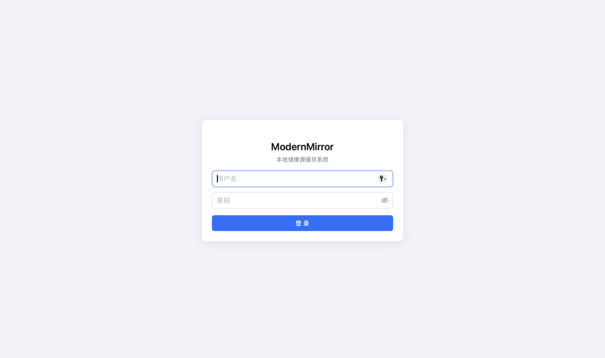
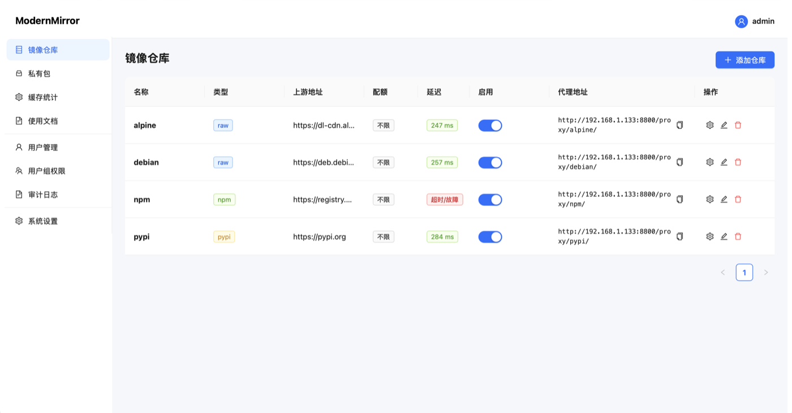
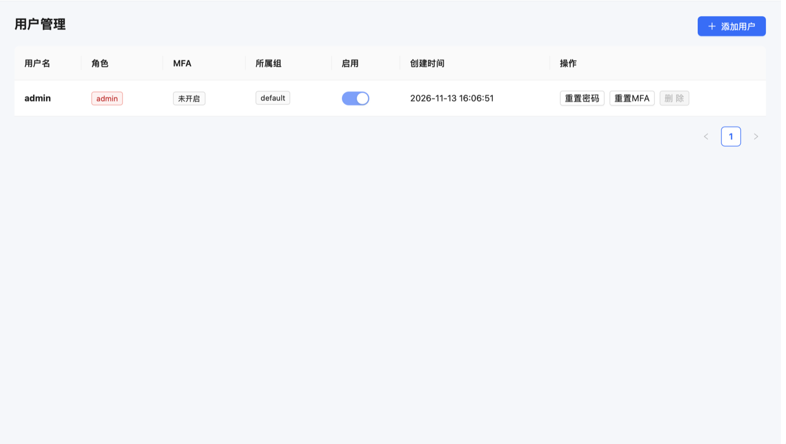
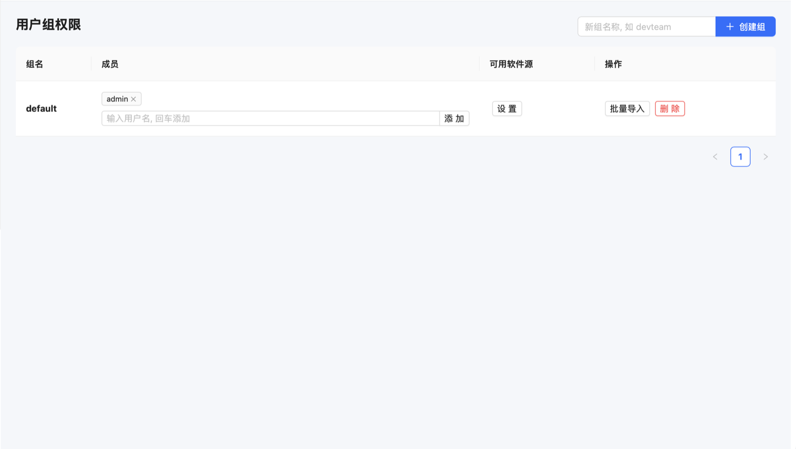
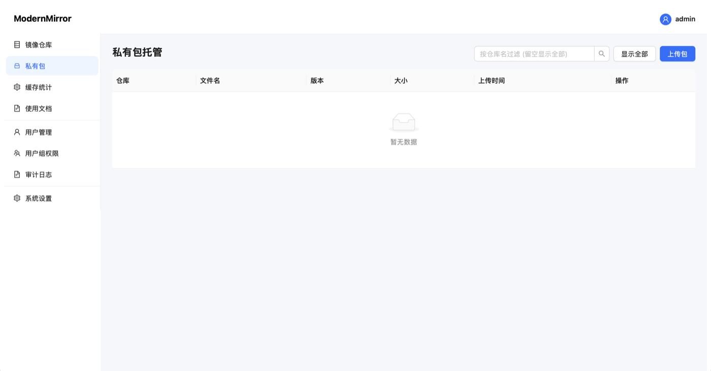
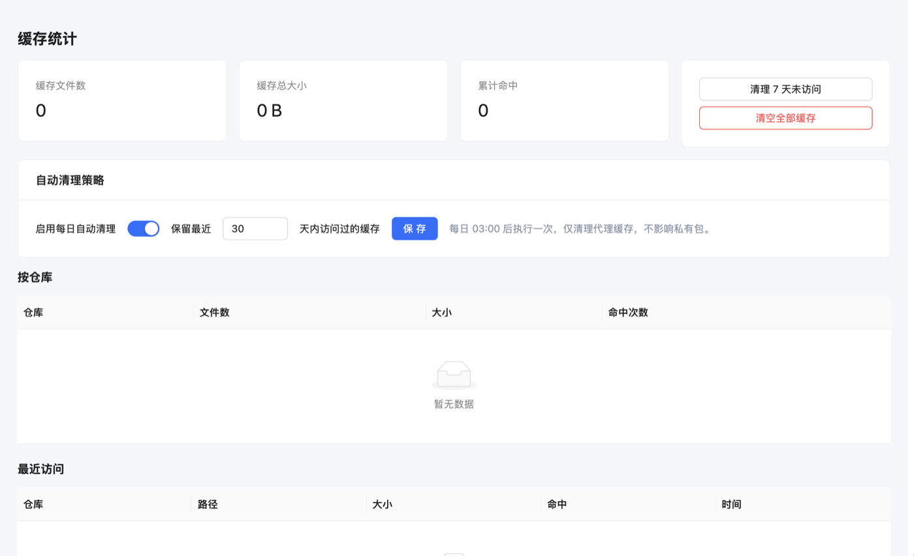
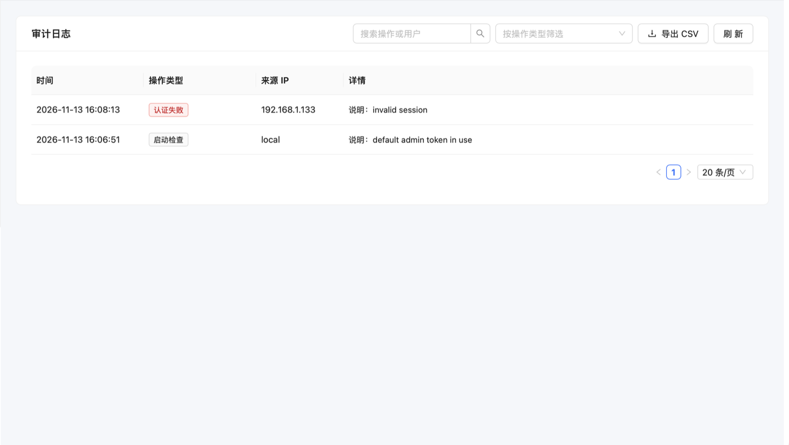
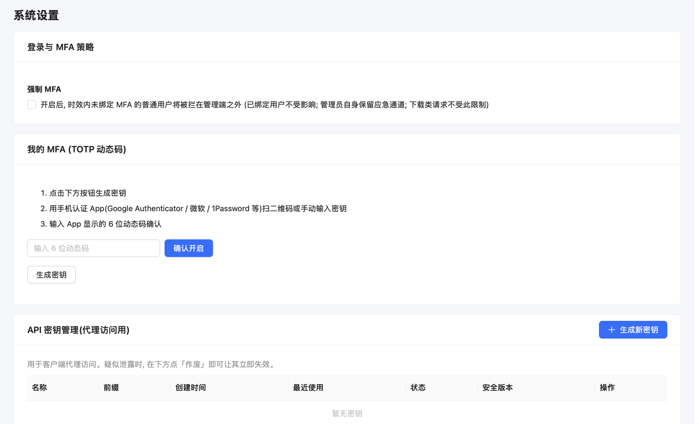
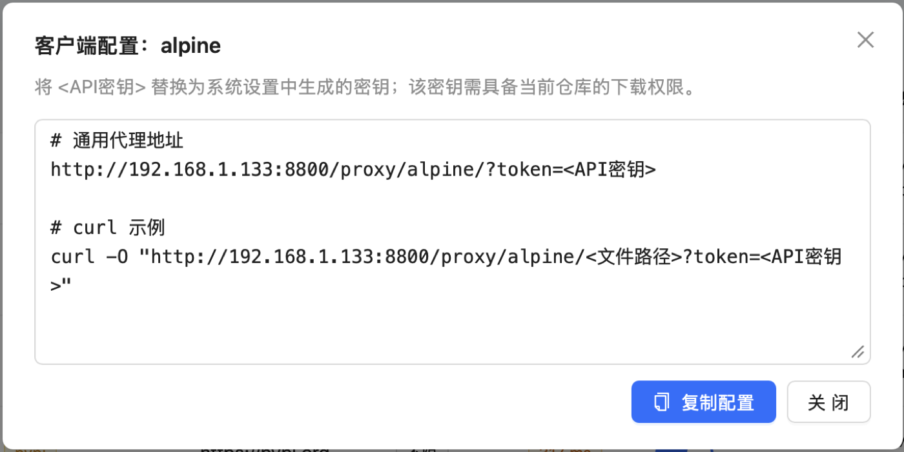
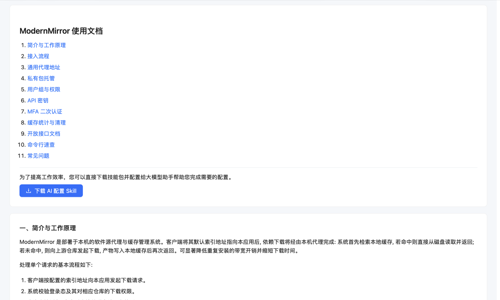

<p align="center">
  
</p>

<h1 align="center">ModernMirror</h1>

<p align="center"><strong>A lightweight, self-hosted caching proxy for package registries.</strong><br>
Cache PyPI, npm, Go, Maven, NuGet, RubyGems, apt/yum and more on your own machine, so repeated installs inside a team never hit the public internet twice.</p>

<p align="center">English | <a href="README.md">简体中文</a></p>

> ModernMirror is an independent project and is not affiliated with Nexus or Verdaccio. It is aimed at studios, homelabs and small teams that need a simple internal mirror.

## Features

- **Transparent caching proxy**: fetch once from upstream, then serve from local disk; ETag revalidation and an `X-Cache-Status` response header
- **Many ecosystems**: PyPI, npm, Go Modules, Maven/Gradle/SBT, NuGet, RubyGems, Crates, Conan, Dart pub, Hex, Hackage, CRAN, LuaRocks, CocoaPods, plus any file-based apt/yum mirror
- **Upstream failover**: one primary and multiple backup upstreams per repository, tried in order
- **Cache management**: per-repository hit and size statistics, quotas, LRU eviction, age-based cleanup and a daily cleanup job
- **Private packages**: upload internal artifacts, with direct download URLs and a PEP 503 simple index
- **Users and permissions**: multi-user login, group-by-repository read/write matrix, bulk member import
- **MFA**: standard TOTP compatible with any authenticator, optional enforcement and admin reset
- **API keys**: separately issued and revocable keys for CI and command-line clients
- **Integrity checks**: PyPI index hashes and npm integrity values are verified before caching
- **SM cryptography**: PBKDF2-SM3 password hashing, SM4 authenticated encryption, with migration support for legacy data
- **Audit log**: logins, repository changes, uploads, deletions and verification failures are recorded and encrypted

## Screenshots

<table>
  <tr>
    <td width="50%"><br><sub>Sign-in page</sub></td>
    <td width="50%"><br><sub>Repositories with upstream latency probing</sub></td>
  </tr>
  <tr>
    <td width="50%"><br><sub>User management and MFA status</sub></td>
    <td width="50%"><br><sub>Groups and repository permission matrix</sub></td>
  </tr>
  <tr>
    <td width="50%"><br><sub>Private package hosting</sub></td>
    <td width="50%"><br><sub>Cache statistics and cleanup policy</sub></td>
  </tr>
  <tr>
    <td width="50%"><br><sub>Audit log</sub></td>
    <td width="50%"><br><sub>Settings and API keys</sub></td>
  </tr>
  <tr>
    <td width="50%"><br><sub>Client configuration snippets</sub></td>
    <td width="50%"><br><sub>Built-in documentation</sub></td>
  </tr>
</table>

## How it works

```
pip / npm / curl / apt
        │
        ▼
  /proxy/{repo}/{original path}
        │
   authentication and group permission
        │
   local cache lookup ──hit──▶ stream from disk
        │
      miss
        ▼
   request upstreams in priority order
        │
   integrity check ──fail──▶ reject, audit, return 502
        │
   atomic write to cache, then respond
```

## Quick start

### Requirements

- Python 3.11 or newer
- Node.js 18 or newer, only needed for the first UI build
- Linux or macOS; on Windows use WSL

### Run

```bash
git clone https://github.com/PlayWithAndyJin/ModernMirror.git ModernMirror
cd ModernMirror
./start.sh
```

The first run creates a virtual environment, installs dependencies, builds the frontend and initializes data under `backend/data/`.

- Admin UI: `http://localhost:8800/ui/`
- API docs: `http://localhost:8800/docs`, admin login required

The first start creates `admin / admin123`. **Change the password immediately and generate an API key in Settings.**

### Recommended first steps

1. Sign in, change the admin password and create an API key
2. Open **Groups**, make sure the `default` group has **download** permission on the repositories you need
3. Create users or use bulk import, then add them to the relevant groups
4. Point your package managers at ModernMirror using the examples below

## Configuration

All settings are environment variables; defaults are shown below.

| Variable | Default | Description |
|---|---|---|
| `MODERNMIRROR_DATA` | `backend/data` | Data directory for the database, cache, private packages, audit log and master key |
| `MODERNMIRROR_HOST` | `0.0.0.0` | Listen address |
| `MODERNMIRROR_PORT` | `8800` | Listen port |
| `MODERNMIRROR_TOKEN` | unset | Emergency admin token; the literal default `admin-token` is intentionally ignored |
| `MODERNMIRROR_ADMIN_USER` | `admin` | Admin username used during first initialization |
| `MODERNMIRROR_ADMIN_PASSWORD` | `admin123` | Admin password used during first initialization |
| `MODERNMIRROR_DB_MASTER_KEY` | generated | Master key; takes precedence over `DATA_DIR/master.key` |
| `MODERNMIRROR_MAX_MB` | `2048` | Maximum size of a proxied file |
| `MODERNMIRROR_MAX_UPLOAD_MB` | `2048` | Maximum size of a private package upload |
| `MODERNMIRROR_RATE_LIMIT` | `600` | Requests per IP per 60 seconds |
| `MODERNMIRROR_SESSION_HOURS` | `24` | Initial session lifetime |
| `MODERNMIRROR_WEB_SESSION_MINUTES` | `30` | Sliding web session lifetime |

Example:

```bash
MODERNMIRROR_PORT=8800 \
MODERNMIRROR_TOKEN="$(openssl rand -hex 24)" \
MODERNMIRROR_ADMIN_PASSWORD="replace-with-a-strong-password" \
./start.sh
```

## Usage

Proxy URL format:

```
http://<host>:8800/proxy/<repo>/<original path>
```

Authentication methods, in priority order:

1. `Session-Token: <API key>` header
2. `Authorization: Bearer <API key>` header
3. HTTP Basic, any username and the API key as password
4. `?token=<API key>` query parameter

> Clients differ in whether they preserve query strings on redirected or relative requests. For clients that cannot set headers, prefer Basic auth or inject a `Session-Token` header at the reverse proxy.

### Examples

**Python / pip**

```bash
pip config set global.index-url "http://mm:<API_KEY>@HOST:8800/proxy/pypi/simple/"
pip install requests
```

**Node.js / npm**

```bash
npm config set registry "http://HOST:8800/proxy/npm/"
npm config set //HOST:8800/:_authToken "<API_KEY>"
npm install antd
```

**Go Modules**

```bash
export GOPROXY="http://HOST:8800/proxy/go/"
go get example.com/module@latest
```

If your Go client cannot send custom headers, inject them at the reverse proxy or use the mirror only on a trusted network.

**Maven / Gradle**

```xml
<mirror>
  <id>modernmirror</id>
  <mirrorOf>central</mirrorOf>
  <url>http://HOST:8800/proxy/maven/</url>
</mirror>
```

**apt and any file-based repository**

Create a repository of type `raw` with upstream `https://deb.debian.org`, then configure a source that supports Basic credentials:

```
deb http://mm:<API_KEY>@HOST:8800/proxy/debian bookworm main
```

**curl**

```bash
curl -H "Session-Token: <API_KEY>" \
  -O "http://HOST:8800/proxy/raw/path/to/file.tar.gz"
```

## Private packages

Upload from the **Private packages** page, or use the API:

```bash
curl -H "Session-Token: <API_KEY>" \
  -F "file=@my-package-1.0.0.whl" \
  "http://HOST:8800/admin/packages/my-repo"
```

Downloads and index:

```
/pkg/<repo>/<filename>
/simple/<repo>
```

SHA256 is computed and stored on upload. Re-uploading the same filename replaces the previous file. Upload permission is controlled by the group matrix; admins can always upload.

## Permission model

```
Admin role
 ├── Users: create, edit, reset password, reset MFA, enable or disable
 ├── Groups: members, repository permission matrix, bulk import
 └── System: repositories, cache, audit, settings

Group × repository
 ├── Download: access /proxy, /pkg and /simple
 └── Upload: publish private packages to that repository
```

Important details:

- **Admins also need a group grant to use proxy repositories.** The admin role only affects management APIs, not repository access
- New users join the `default` group automatically, but that group still needs repository permissions
- Admin uploads bypass the group upload check
- Disabled users cannot log in and their existing sessions become invalid immediately
- The system refuses to delete or disable the last enabled admin

## MFA and API keys

- Bind TOTP for your own account in **Settings**; Google Authenticator, Microsoft Authenticator and 1Password all work
- Admins can reset MFA for other users in **Users**
- When **Require MFA** is enabled, ordinary users without MFA cannot access management APIs; admins keep an emergency path
- API keys are shown once and stored only as an SM3 hash; they can be revoked at any time
- Legacy keys are upgraded to the current hash format on first use

## Security

- **HTTPS-only upstreams**: plain HTTP upstreams are rejected when creating or editing repositories
- **Artifact verification**: PyPI artifacts are checked against the simple index SHA256 or MD5, npm tarballs against `dist.integrity`; mismatches are rejected with 502
- **Encryption by default**: a master key is generated on first start, audit logs and MFA secrets use SM4 authenticated encryption, and passwords use PBKDF2-SM3
- **Session handling**: only token hashes are stored, sessions slide and can be revoked immediately, disabled users lose access at once
- **Path safety**: cache files are content-addressed, upload filenames are reduced to a basename, repository names use a strict character set
- **Capacity limits**: file size, upload size and per-IP rate limits reduce abuse and disk exhaustion
- **Audit trail**: sensitive events are written to an encrypted log

Before exposing the service:

1. Set a strong random `MODERNMIRROR_TOKEN`
2. Put Nginx or Caddy in front and terminate HTTPS; do not expose port 8800 directly
3. Back up `DATA_DIR/master.key`; encrypted data cannot be recovered without it
4. Back up the database and private package directory regularly

## Data layout

```
backend/data/
├── modernmirror.db      SQLite database
├── master.key           master encryption key
├── audit.log            encrypted audit log
├── cache/               proxy cache, safe to delete
└── private/             private package files
```

Back up `modernmirror.db`, `master.key` and `private/`. The cache can be rebuilt.

## Management API

All endpoints require an admin session or token.

```
GET    /admin/repos                 list repositories
POST   /admin/repos                 create a repository
PUT    /admin/repos/{name}          update a repository
DELETE /admin/repos/{name}          delete a repository
GET    /admin/ping                  upstream latency probe
GET    /admin/stats                 cache statistics
POST   /admin/cache/cleanup         clean cache by age
GET    /admin/users                 list users
POST   /admin/users                 create a user
PUT    /admin/users/{name}          update a user
DELETE /admin/users/{name}          delete a user
GET    /admin/groups                groups and permissions
POST   /admin/groups                create a group
POST   /admin/groups/{id}/members   add a member
POST   /admin/groups/{id}/members/import  bulk import members
POST   /admin/groups/{id}/repos/{repo}    set repository permission
GET    /admin/packages              list private packages
POST   /admin/packages/{repo}       upload a private package
GET    /admin/audit                 audit log
GET    /admin/settings              read settings
PUT    /admin/settings              update settings
```

See `/docs` for full request and response schemas.

## Development

Backend:

```bash
cd backend
python3.12 -m venv venv
./venv/bin/pip install -r requirements.txt
MODERNMIRROR_PORT=8800 ./venv/bin/python -m app.main
```

Frontend dev server:

```bash
cd frontend
npm install
npm run dev
```

The dev server runs at `http://localhost:5173/ui/` and proxies API calls to `http://localhost:8800`.

Smoke test:

```bash
cd backend
./venv/bin/python tests/smoke.py
```

## Running as a service

The `deploy/` directory contains a systemd unit and environment file example. Adjust the paths and install them on your host.

## FAQ

<details>
<summary>401 or 403 responses</summary>

401 means missing or expired credentials. 403 means the user lacks permission on that repository. Check group grants, and make sure the admin account has also joined the group.

</details>

<details>
<summary>502 with a hash mismatch message</summary>

The upstream file does not match its official metadata and was rejected. Switch to a trusted upstream and inspect the expected and actual hashes in the audit log.

</details>

<details>
<summary>Clients still see an old version</summary>

Some clients keep their own index cache; clear it and retry. Proxy cache can be cleaned from the **Cache statistics** page.

</details>

<details>
<summary>Port already in use</summary>

Change `MODERNMIRROR_PORT`, or stop the process holding the port and restart.

</details>

<details>
<summary>Forgot the admin password</summary>

Use another admin account to reset it. If none exists, back up the data and reinitialize the database. Never delete `master.key`.

</details>

## Contributing

Issues and pull requests are welcome. Please read [CONTRIBUTING.md](CONTRIBUTING.md) first. For security issues, do not open a public issue; see [SECURITY.md](SECURITY.md).

## License

[MIT](LICENSE)

ModernMirror is provided as is, without warranty regarding the availability, integrity or compliance of external package sources. Make sure you have the right to access and use the upstreams you configure.
